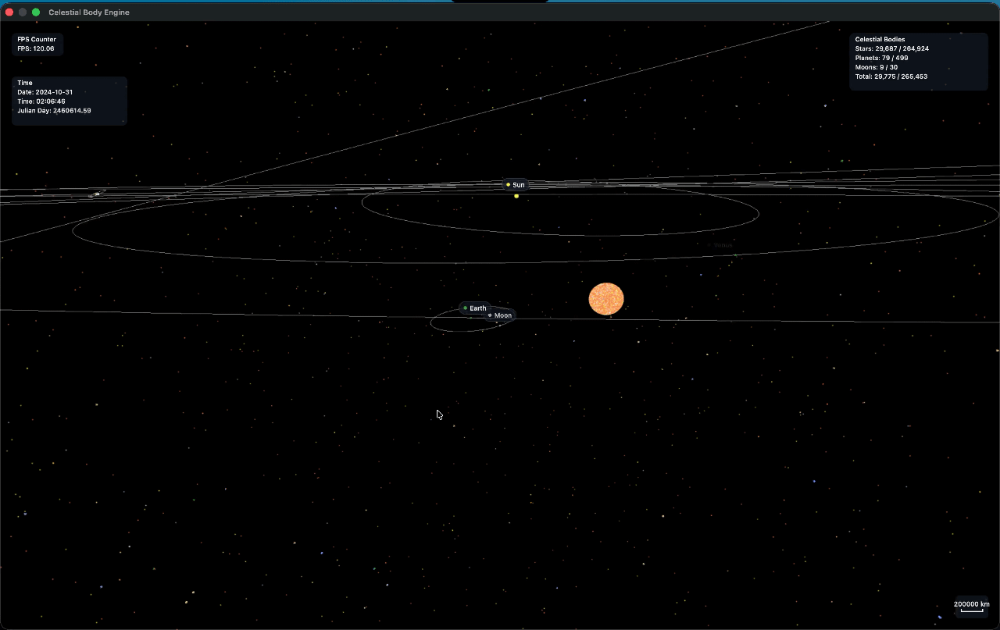

# Celestial Body Engine

A celestial mechanics simulation and 3D visualization engine written in C and Objective-C. It utilizes Apple's Metal framework for high-performance graphics on macOS and features real-time celestial motion based on imported datasets.



## Features
- **3D Rendering:** Native Metal integration for smooth macOS visualization.
- **Modular Data Loaders:** Expandable data format support (currently supports `.json`).
- **Dynamic Time Scale:** Fast-forward, slow down, or reverse time in the simulation.
- **State Saving:** Save simulation states as a checkpoint to resume later.
- **Interactive Camera:** Orbit and zoom around the generated solar system.
- **Debug Overlays:** Real-time metrics including FPS, camera position, simulation date, and wireframe views.

## Showcase

### Real-time Simulation
https://github.com/user-attachments/assets/6e195b19-34cc-4e56-a581-335d00bd1fc9

### Zoom In Feature
https://github.com/user-attachments/assets/30df6766-37e3-4c9b-941b-9d851f5ac1b6

### Zoom Far Out
https://github.com/user-attachments/assets/163f6b48-8635-43e9-ab76-dc7941f1ac10

### Zoom Back In
https://github.com/user-attachments/assets/834040b2-4ef5-4da0-b0b9-c285a862be19

## Prerequisites
- macOS (Metal API support required)
- CMake `3.23` or newer
- Apple Clang (Command Line Tools)
- [Criterion](https://github.com/Snaipe/Criterion) (Optional, required for running tests)

## Quick Start (Makefile)

The project includes a `Makefile` with convenient shortcuts for building, running, and testing. It uses CMake under the hood to configure the project and fetch dependencies like `cJSON`.

- **`make build`**: Configures and compiles the project.
- **`make run`**: Builds the project and runs the `celengine` executable.
- **`make test`**: Builds the project and runs the included CTest suite.
- **`make clean`**: Removes the `build` directory.

Alternatively, you can manually build using CMake: `cmake -S src -B build && cmake --build build`

## Usage

You can run the engine directly from the build directory or via `make run`. To pass command-line arguments using `make`, use the `ARGS` variable:

```bash
make run ARGS="[OPTIONS]"
# or
./build/celengine [OPTIONS]
```

### Rendering Engine
- `--macos`: Use the Metal rendering engine (Required on macOS).
- `--vulkan`: Use the Vulkan rendering engine.

### Simulation
- `--sim-date <date>`: Set the starting simulation date in UTC (Format: `YYYY-MM-DDTHH:mm:ss`).
- `--time-scale <scale>`: Set the time scale multiplier. Supports positive, negative, and scientific notation (e.g., `1`, `-5`, `1e5`).
- `--data-file <path>`: Load simulation data from a specified file.
- `--save-state <path>`: Output the final state of all celestial bodies to a file when the app closes.

### Options
- `--fps`: Show the FPS counter overlay.
- `--debug`: Enable debug mode, including extensive console logging and overlay metrics.
- `--help`: Display available command-line arguments.

### Example

Load a local JSON dataset, speed up time significantly, show the FPS counter, enable the debug overlay, and save the state upon exiting:

```bash
./build/celengine \
    --macos \
    --debug \
    --fps \
    --time-scale 1e5 \
    --data-file ./src/core/data/loader/json/test_data_file.json \
    --save-state ./checkpoint.save.json
```

## Data File Formats

Currently supported formats:
- `.json`: Standard JSON schema for describing stars, planets, and moons along with their orbital properties.

## Testing

The project uses [Criterion](https://github.com/Snaipe/Criterion) for unit testing and CTest as the test runner. 
To run the test suite locally, ensure Criterion is installed (e.g., via `brew install criterion` on macOS), then run:

```bash
make test
```

The test suite validates:
- Core Math & Raycasting routines
- Astronomical Time conversions
- Dynamic Array data structures
- JSON Data Loader capabilities and Schema validation
- CLI Argument Parsing and configuration states

**Continuous Integration (CI)**
A GitHub Actions workflow (`.github/workflows/tests.yml`) is included to automatically build the engine and run the full test suite on every push to the `master` branch.

## Future Feature Implementations

- Added search bar for celestial bodies (with hotkeys)
- Implement man made satellite data fetching
- Implement man made satellite rendering
- Add CLI flag to skip rendering shader textures
- Add planet ring rendering (e.g: Saturn)
- Implement Asteroid belt rendering
- Implement Neutron star rendering
- Implement Pulsars
- Implement Black hole rendering
- Implement Quasars
- Add realistic lighting (sun at center, etc...)
- Add celestial body fixed viewing point (for watching celestial bodies from a body's surface)